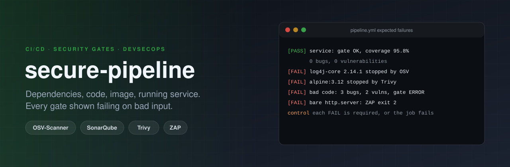

<p align="center"></p>

# secure-pipeline

[](https://github.com/ErenOzgu/secure-pipeline/actions/workflows/pipeline.yml)


**Does the pipeline stop bad things, or does it only print a green tick?** A small Java service and a CI pipeline that
checks its dependencies, its code, its container image and the running service, and then does what most pipelines never
do: feeds each check something that is wrong on purpose and requires it to fail. A scanner that has never been seen
failing proves nothing, because a misconfigured one also exits 0.

| Question | Tool | Fails the build when | Shown failing on |
|---|---|---|---|
| Is a dependency known to be vulnerable? | [OSV-Scanner](https://google.github.io/osv-scanner/) | any known vulnerability in `service/pom.xml` | `log4j-core 2.14.1` (Log4Shell) |
| Is the code good enough to merge? | [SonarQube](https://www.sonarsource.com/products/sonarqube/) Community, with a quality gate kept in this repo | a bug, a vulnerability, coverage under 80 %, a rating worse than A | hard-coded password, MD5, SQL built by concatenation, an unclosed stream |
| Is the container image clean? | [Trivy](https://trivy.dev/) | a fixable HIGH or CRITICAL vulnerability; base image not pinned by digest | `alpine:3.12` |
| Does the running service answer safely? | [OWASP ZAP](https://www.zaproxy.org/) baseline | any warning, not only errors | a bare `python -m http.server` |

The GitHub Actions pipeline is the one that runs. A [GitLab CI version](.gitlab-ci.yml) of the same stages is included
and **has not been run on GitLab**: it is checked against GitLab's published schema on every push, nothing more.

## What the pipeline does

| Job | What it proves | In one CI run |
|---|---|---|
| **Build, test, coverage floor** | Java 21, JUnit 6, JaCoCo with a hard floor of 80 % of lines | 22 tests, 95.8 % coverage |
| **Image builds, starts, answers** | the image starts as user 10001, answers `/healthz`, rejects `?name=<script>` with 400, sends `nosniff`; Trivy finds nothing fixable; a deliberately old image fails the same scan | service: 0 vulnerabilities. `alpine:3.12`: 1 CRITICAL, rejected |
| **Known-vulnerable dependencies** | `tools.lock` agrees with the publishers' own checksum files; the service has no known-vulnerable dependency; a pom with Log4Shell must fail with its advisory id | exit 1, nine advisories, Log4Shell's `GHSA-jfh8-c2jp-5v3q` among them |
| **Code quality gate** | the service passes the gate condition by condition; the bad-code project must fail it | service: reliability 1, security 1, maintainability 1, coverage 95.8, 0 bugs, 0 vulnerabilities. bad code: gate ERROR, reliability E, security D, 3 bugs, 2 vulnerabilities |
| **Running service, passive scan** | ZAP baseline on the service reports no warning; the same scan on a server without defensive headers must report them | service: 0 FAIL, 0 WARN, 67 PASS, 1 rule ignored (reason in `scan/zap-baseline.conf`). lax server: 6 warnings, exit 2 |
| **GitLab version is valid** | `.gitlab-ci.yml` passes GitLab's schema, and the validator rejects a deliberately broken file | |

Every "must fail" step checks the exit status **and** that the output names the problem, so a scanner that fails
for a wrong reason (a network error, a bad flag) does not count as a pass.

## Try it

You need Java 21, Maven and, for the image, Docker.

```sh
git clone https://github.com/ErenOzgu/secure-pipeline && cd secure-pipeline
mvn --file service/pom.xml verify                 # tests, coverage floor, the jar
docker build -t pipeline-service service && docker run --rm -p 8080:8080 pipeline-service
curl -i localhost:8080/hello?name=Ada             # hello, Ada, with eight defensive headers
```

The scanners run in CI. To run one by hand, `scripts/fetch-tool.sh osv-scanner` (or `trivy`) downloads it into
`tools/bin/` after checking it against `tools.lock`; `scripts/sonarqube.sh` and `scripts/zap-baseline.sh` are what the
jobs call.

## The service

`GET /healthz`, `GET /version`, `GET /hello?name=`. Only GET and HEAD (other methods get 405 with `Allow`), the name is
validated (letters, digits, space, `. _ -`, at most 64), an unexpected error is a 500 with no detail, and every response
carries `Cache-Control: no-store`, `X-Content-Type-Options`, a `default-src 'none'` content security policy,
`Referrer-Policy`, `Permissions-Policy` and the three cross-origin isolation headers. The image runs as a non-root user
with a health check. It is small on purpose: the pipeline is the subject, not the service.

## Decisions worth knowing about

- **The quality gate is code.** SonarQube's built-in gate has no conditions on a first analysis, so code with a hard-coded
  password passes it. `sonar/quality-gate.json` defines eight conditions and the pipeline creates the gate through the API.
- **Tools are pinned and checked.** Actions are pinned to commit SHAs, images to digests. Downloaded tools are checked
  against `tools.lock`, which was filled in on first use and is cross-checked against each publisher's checksum file by
  `scripts/verify-lock.sh`, so a changed line in the lock is a visible, reviewable change.
- **Failures explain themselves.** A failing step writes the tail of the tool's output as an annotation on the run, so the
  reason is on the run page without opening logs.
- **Releases come from the changelog.** A new numbered heading in `CHANGELOG.md` makes the release workflow build the
  jar, check that `service/pom.xml` has the same version, and attach the jar with `SHA256SUMS`.

More in [docs/design-notes.md](docs/design-notes.md).

## Limits

- **The GitLab file is untested on GitLab.** Its images are pinned by version, not digest.
- **ZAP baseline is passive.** It reads responses; it does not attack. It finds missing headers and cookie flags, not injection.
- **SonarQube here is a throw-away server.** The gate is mine, not a team's; a real setup has a long-lived server and a gate the team agreed on.
- **One service, one language.** No Gradle, no multi-module build, no secrets scanning, no SBOM or provenance yet (see the [roadmap](ROADMAP.md)).
- **The vulnerable pom is `vulnerable.pom`, not `pom.xml`,** so GitHub does not raise a dependency alert for a file that is wrong on purpose.
- **Never run in production.** This is a demonstration.

## Layout

```text
service/        the Java service, its tests, its Dockerfile
demo/           the two inputs that are wrong on purpose (vulnerable dependency, bad code)
sonar/          the quality gate as JSON
scan/           ZAP baseline rules
scripts/        fetch-tool, verify-lock, sonarqube, zap-baseline, annotate-tail
tools.lock      sha256 of every downloaded tool
.github/        the pipeline, the release workflow, Dependabot
.gitlab-ci.yml  the GitLab version (not run on GitLab)
```

## More

[Design notes](docs/design-notes.md), [CHANGELOG](CHANGELOG.md), [ROADMAP](ROADMAP.md).

## License

MIT, see [LICENSE](LICENSE).
